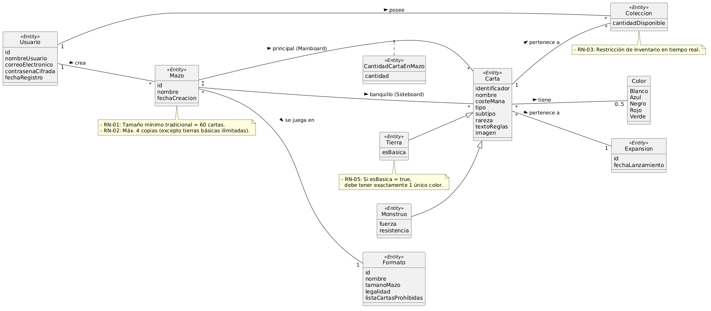

# DECKSMITHS
## MIEMBROS DEL GRUPO:

    1.ÁLVARO AVILÉS VALENZUELA

    2.ÁNGEL RAMÍREZ VEGA

    3.JAVIER CASTILLO IGLESIAS

    4.ROBERTO FRITSCHI LUACES

## 1.Introducción al problema:
   
Magic: The Gathering es uno de los juegos de cartas coleccionables más complejos del mundo, con una trayectoria de décadas y decenas de miles de cartas editadas. Para la comunidad de jugadores, el deckbuilding (o construcción de mazos) representa el núcleo estratégico del juego: una tarea exigente que requiere comprender a fondo las dinámicas, sinergias y complementos entre cartas.

Sin embargo, la realidad práctica de la mayoría de los aficionados dista mucho de ser ideal. Tras años acumulando cartas físicas o digitales, el inventario personal acaba disperso en carpetas, cajas y fundas. Digitalizar este catálogo suele convertirse en una labor tediosa, pesada y que habitualmente se pospone de forma indefinida.

Esta falta de control centralizado deriva en un problema complejo de análisis combinatorio: determinar qué mazos competitivos o viables se pueden construir exclusivamente con las cartas que ya se poseen resulta inalcanzable de forma manual. Como consecuencia, ocurre un doble impacto negativo:

Gasto innecesario: Los jugadores recurren al mercado secundario para adquirir cartas que consideran indispensables, ignorando que ya conservan alternativas funcionales en sus archivadores.

Rendimiento subóptimo: Se termina compitiendo con mazos incompletos por no haber identificado las combinaciones tácticas que permanecían ocultas en la propia colección.

Para responder a esta problemática, se propone una plataforma concebida para simplificar el registro del inventario y eliminar la fricción en el seguimiento del material disponible. El valor diferencial del sistema radica en su motor de generación automática de mazos: a diferencia de las herramientas convencionales —que diseñan listas ideales bajo el supuesto de que el jugador dispone de todo el catálogo existente—, este motor establece la colección real del usuario como el límite estricto de búsqueda.

A partir de este inventario, el sistema evalúa las cartas utilizables, calcula la base de tierras adecuada y genera listas totalmente legales y optimizadas para formatos como Standard o Commander, permitiendo al jugador maximizar su inversión y sacar el máximo partido a sus cartas sobre la mesa.
        
## 2.Glosario de términos
        
Carta: Unidad básica del juego. Posee atributos como coste de maná, color, tipo (criatura, instantáneo, conjuro, tierra) y opcionalmente un efecto y una descripción.
    

Colección: Es el conjunto de cartas de Magic que posee un usuario registrado en el sistema.

Color (Maná): Es el sistema de recursos o "hablidades por categorías" del juego, se define la categoría por colores (Blanco, Azul, Negro, Rojo, Verde e Incoloro). Define la identidad de las cartas y los mazos.

Curva de maná: Distribución gráfica o numérica de las cartas de un mazo según su coste de maná.

Formato: Es el conjunto de reglas que define qué cartas se permite jugar y qué reglaje debe seguir el usuario a la hora de construir su mazo (ya sea Standard o  Commander).

Formato Standard: Los mazos deben contener al menos 60 cartas. Se permiten hasta 4 copias de la misma carta de un listado de cartas permitidas a excepcion de tierras básicas que carecen de limitante. Solo pueden utilizarse cartas de las ultimas colecciones añadidas a magic.

Formato Commander: Los mazos deben contener exactamente 100 cartas. Se permite una única copia de cada carta a excepcion de las cartas básicas, debe incluir obligatoriamente una Criatura Legendaria llamada comandante y todas las cartas deben usar maná de los colores asociados a los del comandante.

Sets: Paquete temático de cartas que se lanza al mercado de forma periódica (varias veces al año). Cada set introduce un conjunto de nuevas cartas.

Mazo (Deck):Es el conjunto de cartas seleccionado por un jugador para disputar una partida. Debe cumplir las restricciones del formato elegido.

Criatura: Son los monstruos, soldados o bestias que invocas para luchar por ti, estas cartas cuentan con un coste de maná (de uno o más colores), un valor asociado a su fuerza y otro a su resistencia, y un efecto y descripción opcionalmente.

Conjuro: Es un  hechizo puntual o una habilidad de una carta de gran poder, que puede ser utilizado tras cumplir una serie de requisitos y consumir la cantidad de mana especificada. (ejemplo: lanzar un rayo)

Tierra: Permite generar maná de los colores especificado por la carta.

Tierra básica: Asociada a un único color, permite generar mana de dicho color, a diferencia del resto de cartas, no existe restriccion de copias para las tierras básicas, pudiendo llevar todas las que el usuario quiera

Cementerio: Es el lugar donde se envía un conjuro tras ser usado o las criaturas eliminadas en combate al jugar una partida

Legalidad: Fecha específica a partir de la cual cartas son legales en un formato; es decir, en un formato sólo se pueden jugar cartas que hayan sido lanzadas posteriormente a dicha fecha.

## 3.Visión general del sistema
        
####Requisitos generales:

 -Gestión Privada de Usuarios y Seguridad de Sesiones

El sistema debe permitir que los usuarios se registren, inicien sesión y accedan de forma segura. Cada jugador debe poder manejar su información, su colección personal y sus mazos. Todo debe estar protegido y no accesible para otros usuarios. Esto se logra con el control de sesiones en el servidor.

- Digitalización y Administración del Inventario Personal

El sistema debe ofrecer herramientas para que los usuarios gestionen completamente su colección de cartas. Estas herramientas incluyen alta, edición y eliminación de elementos. También debe permitir la importación masiva de datos. Además, debe tener un sistema de búsqueda con filtros avanzados para revisar el stock real.

-Motor Automático de Generación, Ajuste y Análisis de Mazos

El sistema debe crear mazos de forma automática según el formato de juego y la sinergia que el jugador desee. Debe calcular el número necesario de tierras y permitir que el usuario revise, cambie, exporte y analice gráficamente las listas generadas.

-Control de Reglas, Administración del Catálogo y Sincronización Externa

El servidor debe asegurar que se cumplan las reglas del juego, como los límites de copias, el tamaño de los mazos, las restricciones de color y la disponibilidad real en el inventario. También debe dar a los administradores herramientas para gestionar el catálogo global, actualizar los formatos y mantener la base de datos sincronizada con servicios externos.

Usuarios del sistema:

  -Jugador: Usuario registrado que sube su colección, consulta cartas y genera mazos.

  -Administrador: Usuario encargado de actualizar la base de datos maestra con las nuevas expansiones de cartas de Magic y de gestionar a los usuarios.

## 4.Catálogo de requisitos
        
  ### Requisitos de información (RI):

  RI-01 Carta: Identificador, nombre, coste de maná, colores, tipo, subtipo, rareza, texto de reglas, expansión, imagen.

  RI-02 Colección (Inventario): Cantidad disponible de cada carta (RI-01) asociada a un Usuario (RI-04).

  RI-03 Mazo: Identificador, nombre, formato, fecha de creación, lista de cartas principales (Mainboard), lista de banquillo (Sideboard).

  RI-04 Usuario: Identificador, nombre de usuario, correo electrónico, contraseña cifrada, fecha de registro.

  RI-05 Formato (de juego): Identificador, nombre, tamaño de mazo, legalidad, lista de cartas prohibidas

  RI-06 Sets de expansión: Identificador, lista de cartas, fecha de lanzamiento

  RI-07 Carta de Monstruo: Fuerza y resistencia

  RI-08 Carta de Tierra: Comprobar si es básica y, de serlo, cumple la restricción de tener un solo color.

  ### Reglas de negocio (RN):

  RN-01 Tamaño mínimo de mazo: Todo mazo generado o validado dentro del sistema para formatos tradicionales (como Standard o Commander) debe contener un total mínimo de 60 cartas. Esta regla actúa como un filtro de seguridad, el sistema no considerará válido ni guardará un mazo en estado "Completado" si el conteo total de sus cartas es inferior a 60

  RN-02 Límite de copias: Un mazo no puede incluir más de cuatro copias de una misma carta en total. La carta se identifica estrictamente por su nombre oficial en inglés (nombre_ingles). La única excepción a esta regla son las cartas que tengan el supertipo “Tierra básica” (Basic Land, como Llanura, Isla, Pantano, Montaña o Bosque). Estas cartas se pueden incluir en cantidad ilimitada dentro del mazo, siempre que el inventario del usuario lo permita.

  RN-03 Restricción de inventario: El generador de mazos funciona dentro de un espacio limitado por la Colección Personal del usuario . No se pueden incluir cartas que el usuario no tenga, ni se permiten más copias de las que estén registradas en su inventario. El sistema revisa en tiempo real cuántas copias de cada carta tiene el usuario  antes de agregarla al mazo. Así se asegura que todos los mazos se creen con base en lo que realmente posee el usuario.
       
   RN-04 Límite de colores por carta: Una carta puede tener entre 0 (incolora) y un máximo de 5 colores asociados.Una carta con 0 colores asociados se clasifica como Incolora (Colorless, como la mayoría de los artefactos y tierras), mientras que una carta con 5 colores asociados se clasifica como Pentacolor (posee los colores Blanco, Azul, Negro, Rojo y Verde).

  RN-05 Restricción de color para Tierras Básicas: Si una carta es del subtipo Tierra y su atributo esBasica es verdadero, entonces debe tener asociado exactamente 1 único color. 

 ### Pruebas de aceptación de reglas de negocio
 -Prueba para RN-01 (tamaño mínimo de mazo):

Condición inicial: El usuario selecciona o intenta generar un mazo para el formato Standard que contiene un total de 55 cartas.

Acción: El sistema ejecuta el proceso de validación para cambiar el estado del mazo a "Completado" o guardar el resultado.

Resultado esperado: El sistema no permite guardar el mazo en estado "Completado", notifica al usuario que no alcanza el tamaño mínimo de 60 cartas y lo mantiene en estado borrador hasta completar la cantidad requerida.         

-Prueba para RN-02 (Límite de copias):

  Condición inicial: El usuario tiene 6 copias de la carta "Relámpago" en su colección.

  Acción: El sistema intenta generar un mazo rojo e incluir las 6 copias.

  Resultado esperado: El sistema incluye solo 4 copias de "Relámpago" en el mazo y busca otras alternativas para rellenar el resto del mazo.

  -Prueba para RN-03 (Restricción de inventario):

  Condición inicial: El usuario tiene 0 copias de "Tarmogoyf".

  Acción: Se solicita la generación de un mazo verde de formato Modern.

Resultado esperado: El mazo generado no incluye "Tarmogoyf" en su lista bajo ninguna circunstancia, utilizando solo las cartas disponibles en el inventario del usuario.

-Prueba para RN-04 (Límite de colores por carta):

Condición inicial: El sistema procesa una carta de la colección que cuenta con 6 colores asignados en su registro.

Acción: El sistema valida la información de color asociada a la carta antes de permitir su uso en el generador de mazos.

Resultado esperado: El sistema marca la carta como no válida por exceder el máximo de 5 colores permitidos (o 0 para incoloras) y no la clasifica en ninguna categoría válida de color.

-Prueba para RN-05 (Restricción de color para Tierras Básicas):

Condición inicial: Existe en el sistema una carta con el subtipo "Tierra" y el atributo esBasica en verdadero, pero tiene registrados 2 colores (o 0 colores).

Acción: El sistema valida la carta durante la asignación de tierras básicas al mazo.

Resultado esperado: El sistema detecta la inconsistencia, rechaza la inclusión de dicha carta como tierra básica y exige que la carta tenga asociado exactamente 1 único color.

### Requisitos funcionales (Solo listados y consultas)

RF-01: **Consultar ficha completa de una carta**
         
Como usuario del sistema, 
quiero abrir la ficha completa de cualquier carta de la base de datos central, visualizando sus datos oficiales:
Nombre en español e inglés, coste de maná, tipo, efecto, descripción,         ilustracion, set y formatos legales,
para conocer con precisión las características y reglas oficiales de la carta.
  
RF-02: **Listar y filtrar la colección personal del usuario**
          
Como coleccionista,
quiero consultar un listado paginado con las cartas de mi inventario personal, filtrable por color, tipo, rareza
o coste, y con el recuento exacto de copias,
para gestionar y conocer el estado real de mi inventario digital o físico.
            
RF-03: **Listar mazos generados**
         
Como usuario interesado en la creación de mazos, 
quiero visualizar un listado general con todos los mazos que he creado o guardado en el sistema, indicando su nombre,
formato y fecha de última modificación,
para acceder rápidamente a cualquier mazo previamente guardado.

 RF-04: **Consultar composición detallada de un mazo**
  
Como usuario interesado en la creación de mazos,
quiero seleccionar un mazo específico para poder revisar las cartas que contiene organizado por tipo de carta 
(criaturas, hechizos, tierras) y zonas (mazo principal o comandante), junto con el número de copias de cada carta,
para analizar la estructura interna y composición del mazo seleccionado.

RF-05: **Buscar cartas en la base de datos maestra**
          
Como usuario del sistema,
quiero realizar búsquedas avanzadas en el catálogo global aplicando filtros combinados por nombre, 
texto de reglas, coste de maná convertido, formato y set,
para localizar rápidamente cartas específicas dentro de la base de datos general de Magic.
    
  RF-06: **Sugerir mazos viables según la colección (Motor de Sugerencias)**
         
Como jugador que busca nuevas opciones de juego,
quiero que el sistema analice mi inventario personal y lo compare con listas de mazos ya creados, 
mostrándome sugerencias ordenadads por lel porcentaje de cartas que ya poseo,
para identificar qué mazoz funcionales puedo armar inmediatamente o con adquisiciones mínimas.
         
  RF-07: **Consultar cartas faltantes y coste de adquisición**
         
Como jugador interesado en completar un mazo,
quiero generar una lista exacta de las cartas y cantidades que me faltan para terminar un mazo incompleto, 
junto con una estimación económica basada en precios actuales de mercado,
para planificar mis compras de forma eficiente.
         
  RF-08: **Consultar métricas y análisis estadístico del mazo**
         
Como usuario interesado en la creación de mazos,
quiero visualizar gráficos de análisis de un mazo, como la curva de maná, proporciones de colores frete a 
fuentes de maná y coste medio de las cartas del mazo,
para comprobar si la baraja está equilibrada y es competitiva.

RF-09: **Garantizar la privacidad de los mazos de usuario**
        
Como propietario de un mazo,
quiero que mis listas de mazos creados sean estrictamente privadas y bloqueadas frente a otros usuarios
o visitantes no autorizados,
para proteger mis estrategis de juego y creaciones personales frente a terceros.

RF-10: **Consutar historial de modificaciones y versiones del mazo**
       
Como usuario interesado en la creación de mazos,
quiero que el sistema guarde un registro automático de cada cambio en mis barajas, permitiéndome consultar
una línea temporal y comparar dos versiones con las adiciones o bajas resaltadas,
 para evaluar la evolución histórica de mis listas y deshacer cambios si es necesario.

   
        

