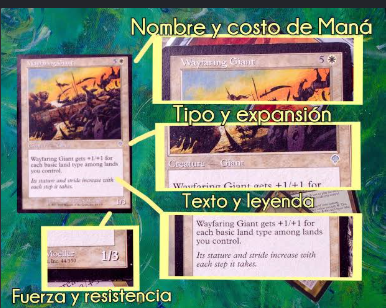
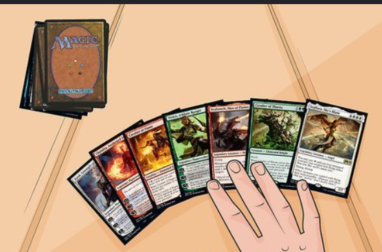
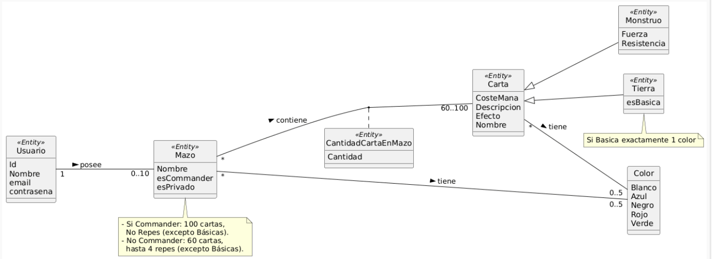

# DECKSMITHS
## MIEMBROS DEL GRUPO:

    1.ÁLVARO AVILÉS VALENZUELA

    2.ÁNGEL RAMÍREZ VEGA

    3.JAVIER CASTILLO IGLESIAS

    4.ROBERTO FRITSCHI LUACES

## 1.Introducción al problema:
   
Magic: The Gathering es uno de los juegos de cartas coleccionables más complejos del mundo, con una trayectoria de décadas y decenas de miles de cartas editadas. Para la comunidad de jugadores, el deckbuilding (o construcción de mazos) representa el núcleo estratégico del juego: una tarea exigente que requiere comprender a fondo las dinámicas, sinergias y complementos entre cartas.

Sin embargo, la realidad práctica de la mayoría de los aficionados dista mucho de ser ideal. Tras años acumulando cartas físicas o digitales, el inventario personal acaba disperso en carpetas, cajas y fundas. Digitalizar este catálogo suele convertirse en una labor tediosa, pesada y que habitualmente se pospone de forma indefinida.

Esta falta de control centralizado deriva en un problema complejo de análisis combinatorio: determinar qué mazos competitivos o viables se pueden construir exclusivamente con las cartas que ya se poseen resulta inalcanzable de forma manual. Como consecuencia, ocurre un doble impacto negativo:

Gasto innecesario: Los jugadores recurren al mercado secundario para adquirir cartas que consideran indispensables, ignorando que ya conservan alternativas funcionales en sus archivadores.

Rendimiento subóptimo: Se termina compitiendo con mazos incompletos por no haber identificado las combinaciones tácticas que permanecían ocultas en la propia colección.

Para responder a esta problemática, se propone una plataforma concebida para simplificar el registro del inventario y eliminar la fricción en el seguimiento del material disponible. El valor diferencial del sistema radica en su motor de generación automática de mazos: a diferencia de las herramientas convencionales —que diseñan listas ideales bajo el supuesto de que el jugador dispone de todo el catálogo existente—, este motor establece la colección real del usuario como el límite estricto de búsqueda.

A partir de este inventario, el sistema evalúa las cartas utilizables, calcula la base de tierras adecuada y genera listas totalmente legales y optimizadas para formatos como Standard o Commander, permitiendo al jugador maximizar su inversión y sacar el máximo partido a sus cartas sobre la mesa.

## 2.Glosario de términos
        
Carta: Unidad básica del juego. Tiene atributos como coste de maná, color, tipo (criatura, instantáneo, conjuro, tierra) y reglas de texto.
    

Colección: Es el conjunto de cartas de Magic que posee un usuario registrado en el sistema.

Color (Maná): Es el sistema de recursos o "hablidades por categorías" del juego (Blanco, Azul, Negro, Rojo, Verde e Incoloro). Define la identidad de las cartas y los mazos.

Formato: Es el conjunto de reglas que define qué cartas son legales para jugar y cómo se construye el mazo (ya sea Standard o  Commander).

Mazo (Deck):Es el conjunto de cartas seleccionado por un jugador para disputar una partida. Debe cumplir las restricciones del formato elegido.

Criatura: Son los monstruos, soldados o bestias que invocas para luchar por ti, son cartas
Conjuro: Es un  hechizo puntual o un habilidad de una carta de gran poder (ejemplo: lanzar un rayo )

Cementerio:Es el lugar donde se envía un conjuro tras ser usado o las cartas eliminadas en combate al jugar una partida

## 3.Visión general del sistema
        
####Requisitos generales:

 -Gestión Privada de Usuarios y Seguridad de Sesiones

El sistema debe permitir que los usuarios se registren, inicien sesión y accedan de forma segura. Cada jugador debe poder manejar su información, su colección personal y sus mazos. Todo debe estar protegido y no accesible para otros usuarios. Esto se logra con el control de sesiones en el servidor.

- Digitalización y Administración del Inventario Personal

El sistema debe ofrecer herramientas para que los usuarios gestionen completamente su colección de cartas. Estas herramientas incluyen alta, edición y eliminación de elementos. También debe permitir la importación masiva de datos. Además, debe tener un sistema de búsqueda con filtros avanzados para revisar el stock real.

-Motor Automático de Generación, Ajuste y Análisis de Mazos

El sistema debe crear mazos de forma automática según el formato de juego y la sinergia que el jugador desee. Debe calcular el número necesario de tierras y permitir que el usuario revise, cambie, exporte y analice gráficamente las listas generadas.

-Control de Reglas, Administración del Catálogo y Sincronización Externa

El servidor debe asegurar que se cumplan las reglas del juego, como los límites de copias, el tamaño de los mazos, las restricciones de color y la disponibilidad real en el inventario. También debe dar a los administradores herramientas para gestionar el catálogo global, actualizar los formatos y mantener la base de datos sincronizada con servicios externos.

Usuarios del sistema:

  -Jugador: Usuario registrado que sube su colección, consulta cartas y genera mazos.

  -Administrador: Usuario encargado de actualizar la base de datos maestra con las nuevas expansiones de cartas de Magic y de gestionar a los usuarios.

## 4.Catálogo de requisitos
        
  ### Requisitos de información (RI):

  RI-01 Carta: Identificador, nombre, coste de maná, colores, tipo, subtipo, rareza, texto de reglas, expansión, imagen.

  RI-02 Colección (Inventario): Cantidad disponible de cada carta (RI-01) asociada a un Usuario (RI-04).

  RI-03 Mazo: Identificador, nombre, formato, fecha de creación, lista de cartas principales (Mainboard), lista de banquillo (Sideboard).

  RI-04 Usuario: Identificador, nombre de usuario, correo electrónico, contraseña cifrada, fecha de registro.

  RI-05 Formato (de juego): Identificador, nombre, tamaño de mazo, legalidad, lista de cartas prohibidas

  RI-06 Sets de expansión: Identificador, lista de cartas, fecha de lanzamiento

  RI-07 Carta de Monstruo: Fuerza y resistencia

  RI-08 

  ### Reglas de negocio (RN):

  RN-01 Tamaño mínimo de mazo: Todo mazo generado o validado dentro del sistema para formatos tradicionales (como Standard o Commander) debe contener un total mínimo de 60 cartas. Esta regla actúa como un filtro de seguridad, el sistema no considerará válido ni guardará un mazo en estado "Completado" si el conteo total de sus cartas es inferior a 60

  RN-02 Límite de copias: Un mazo no puede incluir más de cuatro copias de una misma carta en total. La carta se identifica estrictamente por su nombre oficial en inglés (nombre_ingles). La única excepción a esta regla son las cartas que tengan el supertipo “Tierra básica” (Basic Land, como Llanura, Isla, Pantano, Montaña o Bosque). Estas cartas se pueden incluir en cantidad ilimitada dentro del mazo, siempre que el inventario del usuario lo permita.

  RN-03 Restricción de inventario: El generador de mazos funciona dentro de un espacio limitado por la Colección Personal del usuario . No se pueden incluir cartas que el usuario no tenga, ni se permiten más copias de las que estén registradas en su inventario. El sistema revisa en tiempo real cuántas copias de cada carta tiene el usuario  antes de agregarla al mazo. Así se asegura que todos los mazos se creen con base en lo que realmente posee el usuario.
       
   RN-04 Límite de colores por carta: Una carta puede tener entre 0 (incolora) y un máximo de 5 colores asociados.Una carta con 0 colores asociados se clasifica como Incolora (Colorless, como la mayoría de los artefactos y tierras), mientras que una carta con 5 colores asociados se clasifica como Pentacolor (posee los colores Blanco, Azul, Negro, Rojo y Verde).

  RN-05 Restricción de color para Tierras Básicas: Si una carta es del subtipo Tierra y su atributo esBasica es verdadero, entonces debe tener asociado exactamente 1 único color. 

 ### Pruebas de aceptación de reglas de negocio
 -Prueba para RN-01 (tamaño mínimo de mazo):

Condición inicial: El usuario selecciona o intenta generar un mazo para el formato Standard que contiene un total de 55 cartas.

Acción: El sistema ejecuta el proceso de validación para cambiar el estado del mazo a "Completado" o guardar el resultado.

Resultado esperado: El sistema no permite guardar el mazo en estado "Completado", notifica al usuario que no alcanza el tamaño mínimo de 60 cartas y lo mantiene en estado borrador hasta completar la cantidad requerida.         

-Prueba para RN-02 (Límite de copias):

  Condición inicial: El usuario tiene 6 copias de la carta "Relámpago" en su colección.

  Acción: El sistema intenta generar un mazo rojo e incluir las 6 copias.

  Resultado esperado: El sistema incluye solo 4 copias de "Relámpago" en el mazo y busca otras alternativas para rellenar el resto del mazo.

  -Prueba para RN-03 (Restricción de inventario):

  Condición inicial: El usuario tiene 0 copias de "Tarmogoyf".

  Acción: Se solicita la generación de un mazo verde de formato Modern.

Resultado esperado: El mazo generado no incluye "Tarmogoyf" en su lista bajo ninguna circunstancia, utilizando solo las cartas disponibles en el inventario del usuario.

-Prueba para RN-04 (Límite de colores por carta):

Condición inicial: El sistema procesa una carta de la colección que cuenta con 6 colores asignados en su registro.

Acción: El sistema valida la información de color asociada a la carta antes de permitir su uso en el generador de mazos.

Resultado esperado: El sistema marca la carta como no válida por exceder el máximo de 5 colores permitidos (o 0 para incoloras) y no la clasifica en ninguna categoría válida de color.

-Prueba para RN-05 (Restricción de color para Tierras Básicas):

Condición inicial: Existe en el sistema una carta con el subtipo "Tierra" y el atributo esBasica en verdadero, pero tiene registrados 2 colores (o 0 colores).

Acción: El sistema valida la carta durante la asignación de tierras básicas al mazo.

Resultado esperado: El sistema detecta la inconsistencia, rechaza la inclusión de dicha carta como tierra básica y exige que la carta tenga asociado exactamente 1 único color.

### Requisitos funcionales (Solo listados y consultas)

  RF-01 Consultar catálogo de cartas: El sistema debe permitir abrir la ficha completa de cualquier carta de la base de datos central de Magic. En esta ficha se mostrarán todos sus datos oficiales: nombre en español e inglés, coste de maná, línea de tipo, texto de reglas, ilustración, edición a la que pertenece y los formatos en los que es legal jugar.

  
  RF-02 Listar colección del usuario: El sistema debe mostrar un listado paginado con todas las cartas que el usuario ha añadido a su inventario personal. Esta vista debe permitir organizar y filtrar el inventario por color, tipo de carta, rareza o coste de maná, mostrando claramente la cantidad de copias que posee el usuario de cada carta.

  RF-03 Listar mazos generados:El sistema debe permitir abrir un mazo específico y revisar en detalle las cartas que lo forman. La lista debe presentarse organizada por categorías (criaturas, hechizos, tierras, etc.) y por zonas (mazo principal, banquillo o comandante), indicando cuántas copias hay de cada carta.

  RF-04 Consultar composición de mazo: El sistema debe permitir abrir un mazo específico y revisar en detalle las cartas que lo forman. La lista debe presentarse organizada por categorías (criaturas, hechizos, tierras, etc.) y por zonas (mazo principal, banquillo o comandante), indicando cuántas copias hay de cada carta.

   RF-05 Buscar cartas en la base de datos maestra: El sistema debe permitir buscar cartas en el catálogo global usando filtros combinados por nombre, texto de reglas, coste de maná convertido, formato de juego permitido y edición.

  RF-06 Consultar mazos viables según colección (Motor de Sugerencias):El sistema debe incluir un motor de sugerencias que analice las cartas que el usuario tiene en su inventario y las compare con listas de mazos del juego. El sistema mostrará una lista de mazos sugeridos ordenados según el porcentaje de cartas que el usuario ya posee, desde mazos listos para armar al 100% hasta los que requieran un mínimo de cartas adicionales.

  RF-07 Consultar faltantes y coste de adquisición: Para aquellos mazos que el usuario no tenga completos, el sistema debe generar una lista con las cartas concretas que le faltan para terminarlo y la cantidad exacta de cada una. Además, mostrará una estimación del dinero total que costaría comprarlas según los precios actuales de mercado.

  RF-08 Consultar métricas y análisis del mazo:  El sistema debe generar un análisis visual e intuitivo de cualquier mazo seleccionado para comprobar si está bien equilibrado. Esto incluye gráficos con la curva de maná (cuántas cartas hay de cada coste), la proporción entre los colores del mazo y las tierras disponibles para producirlos, y el coste medio del mazo.

RF-09 Privatización de mazos:Garantizar la privacidad de los mazos,los mazos creados o guardados por un usuario son privados. El sistema impedirá que otros usuarios o visitantes de la plataforma puedan ver, modificar o acceder a las listas de mazos que no les pertenezcan.

RF-10 Consultar historial de modificaciones y versiones del mazo: : El sistema debe guardar un registro automático cada vez que el usuario modifique un mazo. El usuario podrá consultar la línea del tiempo de su mazo y comparar dos versiones para ver resaltadas las cartas que ha ido añadiendo, quitando o cambiando de cantidad.

   
        

